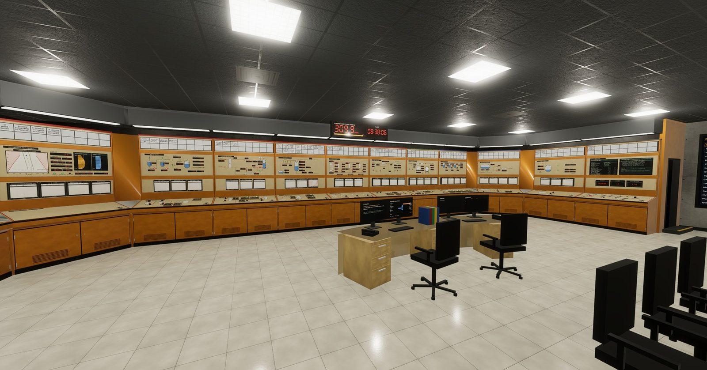
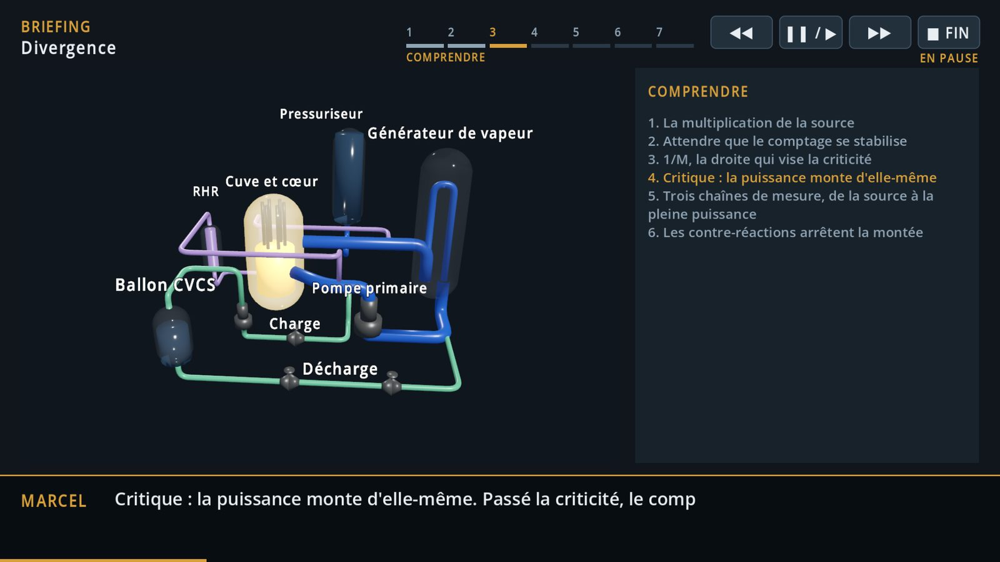
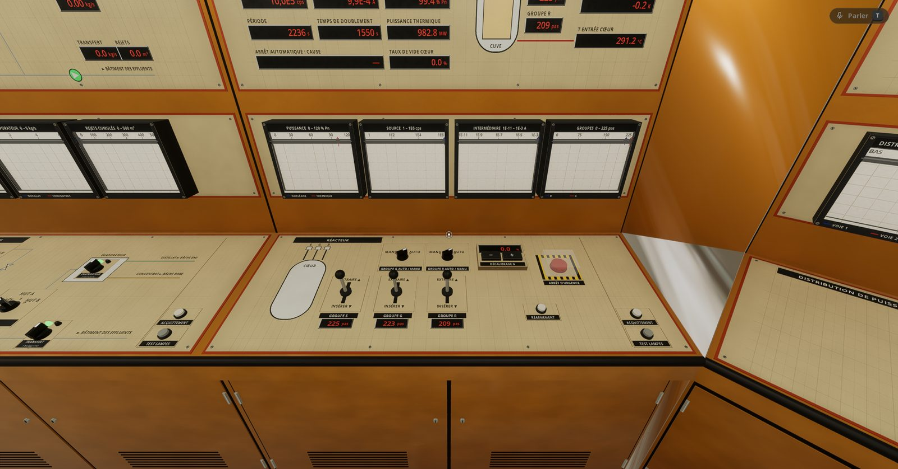
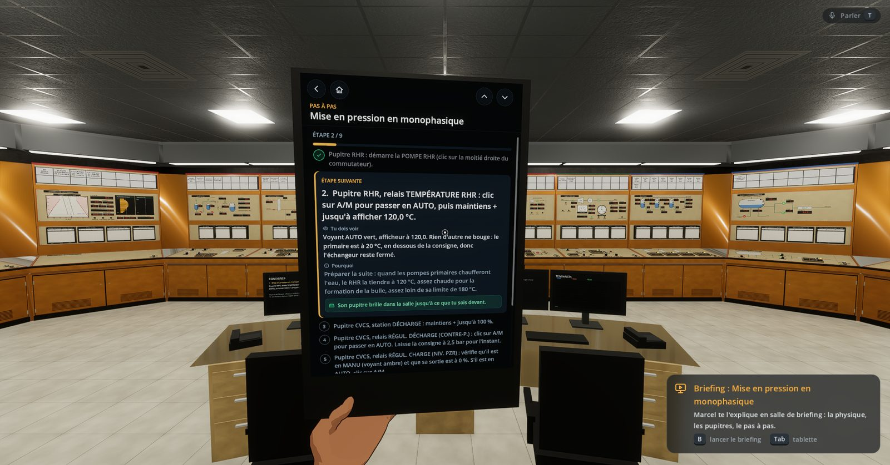
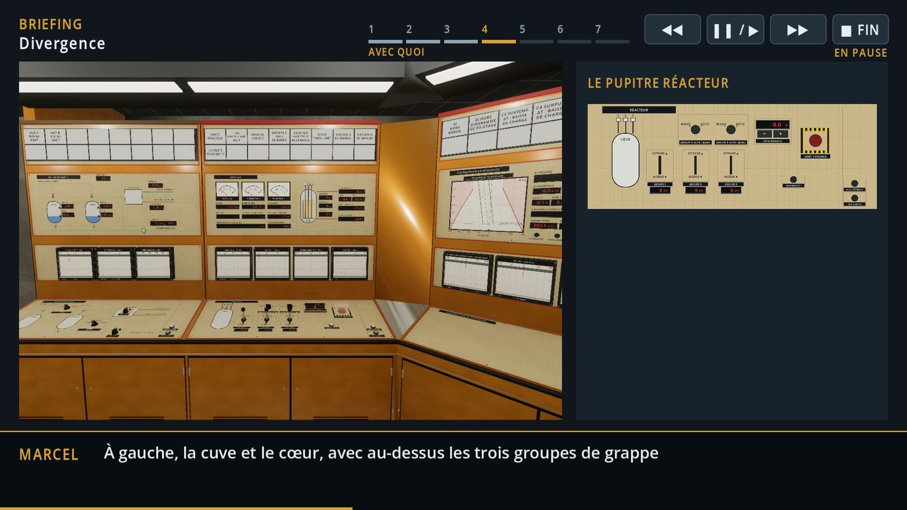
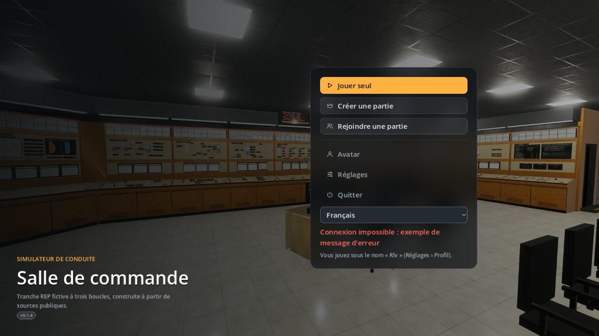
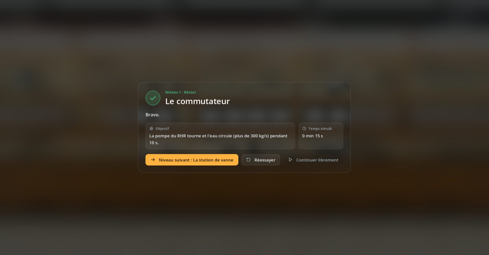

  

<h1 align="center">Simu REP</h1>

  <b>Conduisez un réacteur à eau pressurisée, de l'arrêt à froid à la pleine puissance.</b> 
  <i>Run a pressurized water reactor, from cold shutdown to full power.</i>

  
  
  
  

  <a href="#télécharger"><b>Télécharger</b></a> ·
  <a href="#ce-quon-y-fait">Ce qu'on y fait</a> ·
  <a href="#captures">Captures</a> ·
  <a href="#english">English</a>

---

Simu REP recrée la **salle de commande** d'une tranche nucléaire à eau pressurisée (REP)
fictive, à trois boucles, construite uniquement à partir de **sources publiques**. Chaque
commande des pupitres agit sur un **moteur physique** qui calcule la tranche en continu :
rien n'est scripté, la tranche réagit comme elle doit réagir.

Le but : qu'une personne qui n'a jamais vu une salle de commande comprenne ce qu'on y fait,
et pourquoi.

## Ce qu'on y fait

- **Démarrer la tranche, pas à pas.** Mise en pression, pompes primaires, tirage de la bulle,
  chauffe, basculement vers les générateurs de vapeur, dilution, divergence : 12 niveaux
  jouables, du premier commutateur jusqu'au réacteur critique.
- **Comprendre avant d'agir.** En salle de briefing, Marcel, opérateur chevronné, explique
  chaque phase sur un schéma 3D vivant : la physique, les pupitres, les manœuvres et leurs
  valeurs, ce qui peut mal tourner.
- **Suivre le pas à pas sur une tablette.** L'étape en cours est détaillée (ce qu'on doit voir,
  pourquoi), et son pupitre s'allume dans la salle.
- **Faire face aux incidents.** Une douzaine d'exercices : îlotage, perte des pompes
  primaires, petite brèche, perte des sources électriques, dilution intempestive…
- **Jouer à plusieurs**, en réseau local, avec la voix spatialisée et des avatars.
- **En français ou en anglais**, au choix de chaque joueur.

## Un vrai moteur physique

Écrit en Rust, déterministe (le même calcul donne le même résultat sur toutes les
plateformes) :

- thermohydraulique eau-vapeur (IAPWS-IF97), monophasique et diphasique : primaire,
  pressuriseur, générateurs de vapeur, secondaire, condenseur ;
- cinétique neutronique, cœur nodal avec xénon et répartition axiale de puissance (ΔI),
  contre-réactions modérateur et Doppler, bore ;
- régulations et protections : grappes, pression, niveaux, arrêt automatique, ΔT de
  protection, injection de sécurité ;
- système électrique : réseaux, transformateurs, tableaux 6,6 kV, diesels de secours,
  batteries ; alternateur et turbine.

## Captures

<table>
  <tr>
    <td width="50%"></td>
    <td width="50%"></td>
  </tr>
  <tr>
    <td>En salle de briefing, chaque phase expliquée sur un schéma vivant.</td>
    <td>Le pupitre Réacteur : grappes, période, puissance, enregistreurs.</td>
  </tr>
  <tr>
    <td></td>
    <td></td>
  </tr>
  <tr>
    <td>La tablette : l'étape en cours, ce qu'on doit voir, pourquoi.</td>
    <td>Le briefing montre la salle et le pupitre de chaque manœuvre.</td>
  </tr>
  <tr>
    <td></td>
    <td></td>
  </tr>
  <tr>
    <td>L'accueil : jouer seul, créer ou rejoindre une partie.</td>
    <td>Chaque niveau se termine par son bilan.</td>
  </tr>
</table>

## Télécharger

La dernière version est dans les [**Releases**](https://github.com/Jfrequelin/SimuREP/releases/latest).

| Système | Fichier | Lancer |
| --- | --- | --- |
| Linux (x86_64) | `simu-rep-jeu_<version>_x86_64.AppImage` | `chmod +x`, puis double-cliquer |
| Linux (archive) | `simu-rep-jeu_<version>_linux_x86_64.tar.gz` | décompresser, puis `simu-rep-jeu/simu-rep-jeu.x86_64` |
| Windows 10 ou plus récent | `simu-rep-jeu_<version>_windows_x86_64.zip` | décompresser, puis `simu-rep-jeu.exe` |

Il faut une carte graphique compatible **Vulkan**. Le jeu lance son moteur tout seul et
l'arrête en se fermant ; une partie à plusieurs sur le réseau local demande d'ouvrir le
port 8080 sur le poste de l'hôte. Les paquets ne sont pas signés : Windows (SmartScreen)
demande « Informations complémentaires › Exécuter quand même ». La version Windows n'a encore
été essayée que sous Wine : vos retours sont précieux.

Commandes : <kbd>Z</kbd> <kbd>Q</kbd> <kbd>S</kbd> <kbd>D</kbd> ou les flèches pour marcher, la
souris pour regarder, clic pour manœuvrer, <kbd>Tab</kbd> la tablette, <kbd>B</kbd> le briefing,
<kbd>Échap</kbd> le menu. Toutes les touches se réassignent dans les réglages.

Le **pupitre web** (`simu-rep_<version>`, AppImage ou `.deb`) fait tourner le simulateur dans le
navigateur, en 2D : pratique pour un formateur.

## Où en est le projet

Projet personnel en développement actif.

- **Jouable** : la salle complète, le démarrage jusqu'à la divergence en 12 niveaux, les
  exercices d'incident, le multijoueur en réseau local, l'interface en anglais (les briefings,
  le pas à pas et les fiches d'alarme restent en français pour l'instant).
- **En préparation** : un réseau électrique européen derrière la tranche et un dispatching
  (suivi de charge, réglage de fréquence, journées de conduite notées), la suite du démarrage
  jusqu'à la pleine puissance, le son, la réalité virtuelle.

## À propos

La tranche est **fictive** : ses données viennent de sources publiques, et le projet n'a
aucun lien avec un exploitant ou un constructeur. Ce n'est pas un outil de formation agréé.

Les retours sont bienvenus, en particulier ceux des exploitants et des formateurs : ouvrez
une [*issue*](https://github.com/Jfrequelin/SimuREP/issues).

Fait avec [Godot Engine](https://godotengine.org) et [Rust](https://www.rust-lang.org) ;
personnages construits avec [MakeHuman](http://www.makehumancommunity.org) (CC0).

---

## English

**Simu REP** recreates the **control room** of a fictional three-loop pressurized water
reactor (PWR) unit, built from **public sources** only. Every control on the desks drives a
**physics engine** that computes the plant continuously: nothing is scripted.

**What you do**

- **Start up the plant, step by step**: pressurization, reactor coolant pumps, drawing the
  pressurizer bubble, heatup, switching from RHR to the steam generators, dilution,
  criticality. 12 playable levels, from the first switch to a critical reactor.
- **Understand before acting**: in the briefing room, Marcel, a seasoned operator, explains
  each phase on a live 3D diagram: the physics, the desks, the operations and their values,
  what can go wrong.
- **Follow the procedure on a tablet**: the current step is detailed, and its desk lights up
  in the room.
- **Handle incidents**: a dozen exercises (islanding, loss of the reactor coolant pumps, small
  break, loss of electrical power, inadvertent dilution…).
- **Play together** on a local network, with spatial voice chat and avatars.

**A real physics engine**, written in Rust and deterministic: two-phase thermal-hydraulics
(IAPWS-IF97), neutron kinetics with a nodal core (xenon, axial offset), reactivity feedback,
control and protection systems, and the electrical system (grids, transformers, 6.6 kV
switchboards, emergency diesels, batteries).

**Download** the latest version from the [Releases](https://github.com/Jfrequelin/SimuREP/releases/latest):
the Linux AppImage or archive, or the Windows 10+ zip. A Vulkan-capable graphics card is
required. The game starts in your system language; switch between **English and French** in
Settings › Profile. The menus and desks are in English; the briefings, the step-by-step
procedure and the alarm sheets are still in French for now. The Windows build has only been
tested under Wine so far: feedback is very welcome.

**Status**: personal project under active development. Coming next: a European grid and
dispatch centre behind the plant (load following, frequency control, scored days of
operation), the startup up to full power, sound, and virtual reality.

The plant is **fictional** and the project is not affiliated with any utility or vendor; it
is not a certified training tool. Feedback is welcome: please open an
[issue](https://github.com/Jfrequelin/SimuREP/issues).
